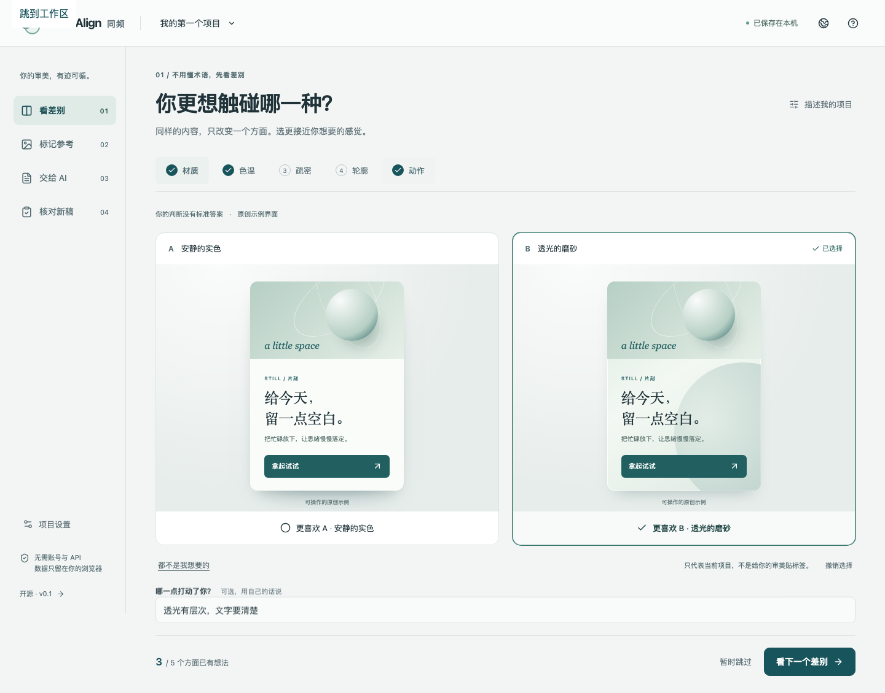

# Taste Align · 同频

**Turn “make it feel right” into design direction an AI can act on.**

A local-first, open-source workspace for people who know what they like but don't speak design jargon. Compare one visual difference at a time, pin what matters in your own references, and export a brief **with its evidence**. Bring the next design back and review against the same requirements.

[中文](README.zh-CN.md) · [Try it](https://easin-yx.github.io/taste-align/) · [Product decisions](PRODUCT.md)

Product direction is maintained in the [product center](PRODUCT.md). The [two-dimensional aesthetic map proposal](docs/AESTHETIC-MAP.md) is a new design/validation direction, not a feature in the live v0.1 app. See [current delivery status](docs/STATUS.md) for implementation and verification evidence.



## The complete loop

1. **Compare** — five working same-content comparisons: material, color temperature, density, shape and motion. Choose A, B, neither, or skip. Add your own reason.
2. **Point** — upload screenshots or short videos; mark a position or timestamp. Specify what to borrow, preserve, or avoid, and only the aspect you mean.
3. **Hand off** — download a ZIP containing `DESIGN_BRIEF.md`, original references, exact note locations, `REVIEW.md`, an editable `project.json`, and captured JPEG frames for video notes.
4. **Review** — upload the result and mark requirements as matching or needing changes. Editing a requirement or replacing the result makes old approval stale.

No account. No API key. No model call. No image uploaded to a server. Chinese and English interfaces. Works on mobile and desktop browsers.

## Give it to an AI

Unzip the bundle into your project and tell your coding assistant:

> Read DESIGN_BRIEF.md. Inspect the referenced images and note positions in assets/. First implement one representative interaction with the same content. Identify conflicting requirements instead of silently guessing. Preserve unrelated functionality. Map the result to each requirement.

For chat-based tools, attach the brief **and the relevant images**. Video notes include a captured JPEG at the recorded timestamp; models without video support can inspect that frame. Motion still requires a playable result. The tool does not automatically send files or claim the AI has inspected them.

## Run locally

Node.js 22.12+ (24 LTS recommended).

```sh
npm ci
npm run dev
```

Open `http://localhost:5193`. Production:

```sh
npm run build
npm run preview
```

`dist/` is a static site. It can be hosted on GitHub Pages, Cloudflare Pages, Netlify, or any static server. Relative asset paths support subdirectory hosting. No server or database is required.

## Verify

```sh
npm test
npx playwright install chromium webkit
# Start npm run dev in a second terminal.
npm run test:e2e
```

Tests cover evidence/unknowns, bundle round-trips, corrupt imports, stale reviews, keyboard access, viewport overflow and the entire browser workflow in Chromium and mobile WebKit. Mobile WebKit automation is not physical iPhone validation.

## Data and limitations

- Projects and media live in this browser's IndexedDB. No cloud sync. Browser clearing/device changes can lose data; exported ZIPs are editable backups.
- Images: PNG, JPEG, WebP. Video: MP4/WebM supported by your browser. Up to 12 references, 30 MB each, roughly 75 MB per project. Large media can be slow on low-memory devices.
- Reference images remain yours/their owners'. The app license does not relicense them.
- The five comparisons are **examples**, not a taste diagnosis. Unknowns remain unknown. Personal references and explicit requirements matter more than sample defaults.
- Review is manual. There is no automatic aesthetic score or promise of perfect AI output.
- No live-page scraping, shared server state, arbitrary HTML rendering, model provider proxy, or telemetry.

## Project structure

- `src/core/` — portable data model, evidence rules, archive and local storage
- `src/components/` — comparison specimen, annotations, handoff and result review
- `src/App.tsx` — workspace and project lifecycle
- `tests/` — unit and end-to-end behavior checks
- `docs/` — research, validation and release evidence

## License and contributions

MIT. Original sample graphics are generated by this project's HTML/CSS and included under MIT. Dependencies retain their own licenses; see [THIRD_PARTY.md](THIRD_PARTY.md). Contributions that make evidence clearer or handoffs more reliable are welcome. See [CONTRIBUTING.md](CONTRIBUTING.md).
